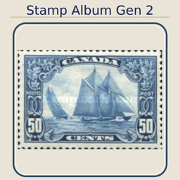
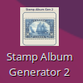
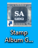
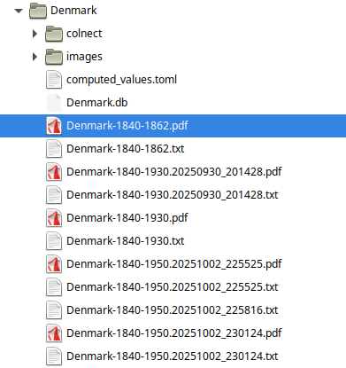
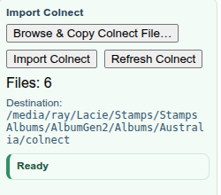

[](https://github.com/amhbamhb/StampAlbumGen2/actions/workflows/release-combined.yml)


# Stamp Album Generator



This application generates AlbumEasy source pages (*.txt files) from stamp data sources and SQLite databases.

Latest release: [Latest release](https://github.com/amhbamhb/StampAlbumGen2/releases/latest)

The application is designed to simplify the process of generating stamp album pages from various data sources, ensuring that users can efficiently manage and update their collections.

Our web site: [Stamp Album Generator 2](https://stampalbumgenerator2.com/)

Our app will always be free to individual collectors, including source code.  Any corporate or commercial, educational use is subject to licensing fees, including any source code usage and any derivative works.  So no, you can not fork, make changes and call it your own for commercial, corporate, educational purposes.

## Start Here

Most people will just launch the binary and automatically start the application. To download the program, visit the [releases page](https://github.com/amhbamhb/StampAlbumGen2/releases/latest). The Web UI is default when starting the program directly.

All files that are needed for the application are created automatically upon the first launch.  Include the config.toml file, which contains the necessary configuration settings for the application.  A help file is also generated to assist users in understanding and using the application effectively.  If the file have been updated a new version will be created automatically.  This also applies to the config.toml.  The web UI will notify the user that there are new config items now active.

This works in both Linux and Windows environments.




There is a help pdf file that is created in the runtime working folder when the application is first launched. The help file is named `StampAlbumGenerator2HelpManual.pdf`. This contains detailed usage instructions and guidance for interacting with the application from a web UI.  

Most people will use the web UI.

For safety, always back up your existing album data before using advanced features or directly manipulating the database.

The Application, on every PDF generation, will always create a backup of the txt file (if one previously existed).




There are also command-line usage instructions available within the PDF.  Some instructions below are provided as examples.

## Advanced Usage

Below are the option that a few brave souls will use to build and run the release binary directly. :)

There are several ways to interact with the application directly from the command line.

You can also build your own version from the source code.  This application is in Rust and uses Cargo as its build system.

To build the release binary and run it, below are installation and usage instructions.  You of course need to download the source code first:

**Note:** The rust system installation is beyond the scope of this document.  Please visit [the official Rust website](https://www.rust-lang.org/) for installation instructions.

```bash
cargo build --release

./target/release/stamp_album_gen2 --db-path Albums/Canada/Canada.db --album-name Canada
```

Show all available switches:

```bash
./stamp_album_gen2 --help
```

Enable PDF generation diagnostics (DX/support mode):

```bash
./stamp_album_gen2 --pdf-dx-logging --review-ui --album-name "Great Britain"
```

Important: when running the binary directly, do not put an extra `--` after `./stamp_album_gen2`.

Correct:

```bash
./stamp_album_gen2 --source colnectexport --colnect-inbox /path/to/colnect_inbox
```

Incorrect:

```bash
./stamp_album_gen2 -- --source colnectexport
```

## Repository Scope

This repository is in the Stamp Gen 2 application repository.  Please visit [the GitHub repository](https://github.com/amhbamhb/StampAlbumGen2). for more information.

## Common Usage Examples

Generate album output from an existing database:

```bash
./stamp_album_gen2 --db-path Albums/Canada/Canada.db --album-name Canada
```

You can also use other sources like StampWorld for a country/year range.  You must have a StampWorld account before using this.  The configuration requires specifying the source, site name, album name, and the year range.  The values are in the config.toml file, including the StampWorld account setup: 

To register for stampworld, visit [StampWorld's registration page](https://www.stampworld.com/en/register) and create an account.

```bash
./stamp_album_gen2 \
 --source stampworld \
 --site-name Great-Britain \
 --album-name "Great Britain" \
 --start-year 1900 \
 --end-year 1950
```

### Remember a StampWorld country URL

For single word country names, the program usually converts them correctly to the URL format automatically.

Multiword country names already convert spaces to hyphens automatically:
`South Korea` becomes `South-Korea`, `British Canada` becomes `British-Canada`,
and `North Korean Occ. South Korea` becomes `North-Korean-Occ.-South-Korea`.

The program tries to automatically convert multiword country names to the correct URL format,  but is not always correct, for stampworld check the url manually to see the proper format.
Quote multiword country names when entering CLI commands.

In the web UI, the resolved country URL is displayed in the **StampWorld Pull** panel.

Both the startup and Review **StampWorld Pull** panels show the resolved country
URL. If automatic naming does not match the site, paste the country page URL
into **StampWorld country URL (optional)** and click **Save country URL**.
Unsaved edits are also validated and saved before a pull starts; invalid URLs
or save failures block that pull. Clear the field and save to restore automatic
naming. Switching countries loads that country's saved setting and discards
unsaved edits from the previous country.

Settings persist across restarts in the existing `slug_overrides.toml` file:
the application searches the working-folder ancestors first, then executable
ancestors, and creates the file in the working folder if none exists. No database
table is needed. Saving preserves other mappings/settings but may reformat the
TOML and remove comments. Malformed or unreadable mapping files produce an
explicit error rather than silently using a different URL.

Mappings are keyed by the exact country name. They affect only the source URL,
not country display names, album names, folders or databases. Each UI pull passes
its resolved URL to the subprocess, so a different pull working folder cannot
cause a different mapping to be used. Existing plain CLI pulls use the saved
mapping; an optional `--stampworld-country-url` argument supplies a one-run
override without saving it:

```bash
./stamp_album_gen2 --source stampworld --site-name "South Korea" \
 --album-name "South Korea" --start-year 1970 --end-year 1980 \
 --stampworld-country-url https://www.stampworld.com/en/stamps/South-Korea/
```

Use a full HTTPS URL under `www.stampworld.com/en/stamps/<country>/`, without
year-range paths, query parameters, credentials or fragments. Validation checks
the URL shape; it does not check whether StampWorld currently serves that page.

### Scrape US1847

This section is a work in progress.  Use it with care and double-check the results. YMMV (Your Mileage May Vary).

```bash
./stamp_album_gen2 \
 --source us1847 \
 --site-name United-States \
 --album-name "United States" \
 --start-year 1847 \
 --end-year 1860
```

### Enter your own stamp data

Normal launches create a blank `UserImport/manual_import_template.csv` and a
local usage guide at `UserImport/README.md` in the runtime working folder.
Missing files are recreated on later launches; existing files are never
overwritten. Copy the template, fill it in, and import the completed CSV using
the existing Colnect import and Review UI workflow. It can be placed inside the colnect import folder structure for the country. They do not automatically update your album stamps.  You have to import these files the same as any new Colnect CSV files.  From the web UI, navigate to the Colnect import section to upload and review your CSV files.



See [User-defined CSV import](docs/guides/USER_DEFINED_CSV_IMPORT.md) for field
definitions, examples, Linux/Windows commands, stable manual IDs, and important
re-import/update limits.

Ingest one Colnect CSV (source must be `colnectexport`):

```bash
./stamp_album_gen2 \
 --source colnectexport \
 --colnect-csv /path/to/en_stamps_csv_list_country_206-Switzerland_year_1972.csv \
 --db-path Albums/Switzerland/Switzerland.db \
 --album-name Switzerland
```

Process a Colnect inbox recursively, auto-route files by country, and create missing country DBs:

```bash
./stamp_album_gen2 \
 --source colnectexport \
 --colnect-inbox /path/to/colnect_inbox \
 --colnect-auto-route \
 --colnect-create-country-db
```

Process a Colnect inbox and auto-generate album pages for countries with successful imports:

```bash
./stamp_album_gen2 \
 --source colnectexport \
 --colnect-inbox /path/to/colnect_inbox \
 --colnect-auto-route \
 --colnect-create-country-db \
 --colnect-generate-after-import
```

Note: by default, inbox mode is ingestion-only. It imports CSV data into country
DBs but does not generate AlbumEasy pages unless
`--colnect-generate-after-import` is set.

After inbox import, generate pages per country from the DB:

```bash
./stamp_album_gen2 --db-path Albums/Switzerland/Switzerland.db --album-name Switzerland
./stamp_album_gen2 --db-path Albums/Canada/Canada.db --album-name Canada
```

If `--colnect-inbox` is omitted for `--source colnectexport`, the program uses
`colnect_inbox_path` from `config.toml` and creates that directory on startup if
it does not exist.

Process only one country from an inbox:

```bash
./stamp_album_gen2 \
 --source colnectexport \
 --colnect-inbox /path/to/colnect_inbox \
 --colnect-country Switzerland
```

Force reimport even if CSV checksum was already imported:

```bash
./stamp_album_gen2 \
 --source colnectexport \
 --colnect-inbox /path/to/colnect_inbox \
 --colnect-force-reimport
```

Initialize local config from template:

```bash
./stamp_album_gen2 --init-config
```

Force overwrite existing config (creates backup first):

```bash
./stamp_album_gen2 --init-config --force-init-config
```

## CLI Switch Reference

### Core

- `--source <SOURCE>`
 Allowed values: `stampworld`, `touchstamps`, `extractfile`, `colnectexport`, `us1847`.
- `--site-name <SITE_NAME>`
 Site/country slug for scraping sources.
- `--album-name <ALBUM_NAME>`
 Album name used for output generation.
- `--db-path <DB_PATH>`
 SQLite DB path for output mode or explicit Colnect target DB.
- `--base-url <BASE_URL>`
 Override default StampWorld URL construction.

### Year Range and Scrape Control

- `--start-year <START_YEAR>` (default: `1840`)
- `--end-year <END_YEAR>` (default: current year at runtime)
- `--max-pages <MAX_PAGES>`
 Maximum pages to fetch when scraping (`0` means no explicit cap).
- `--stop-after-no-hits <N>` (default: `3`)
 Stops after `N` consecutive pages without matching stamps.

### Overwrite and Confirmation

- `--overwrite-album`
 Overwrite generated album output files.
- `--overwrite-images`
 Overwrite downloaded/generated image files.
- `--yes` / `-y`
 Auto-accept top source correction when source appears misspelled.

### Config Bootstrapping

- `--init-config`
 Create `config.toml` from template/defaults and exit.
- `--force-init-config`
 Use with `--init-config` to overwrite existing `config.toml` after timestamped backup.

### Colnect Ingestion

- `--colnect-csv <PATH>`
 Ingest a single Colnect CSV file.
 When used with `--db-path`, this run also proceeds to album generation.
- `--colnect-inbox <DIR>`
 Recursively discover and process Colnect CSV files country-by-country.
 If omitted in `colnectexport` mode, falls back to `colnect_inbox_path` in
 `config.toml`.
 By default this mode is ingestion-only; run a follow-up
 `--db-path ... --album-name ...` command to generate pages, or use
 `--colnect-generate-after-import` to auto-generate in the same run.
- `--colnect-generate-after-import`
 After inbox ingestion, generate album output for each country with at least
 one successful import in this run.
- `--colnect-auto-route`
 Move discovered files into `<inbox>/<country>/` before processing.
- `--colnect-country <COUNTRY>`
 Case-insensitive country filter for inbox processing.
- `--colnect-create-country-db`
 Create missing `Albums/<Country>/<Country>.db` during inbox ingestion.
- `--colnect-skip-duplicates`
 Skip files already imported by SHA256 checksum (default behavior).
- `--colnect-force-reimport`
 Reimport even if checksum already exists in import history.

## Country flags and ISO codes

Country lookup includes the supplied `ISOCountryCodes.csv`, embedded into the
executable at build time. Despite its filename, the file is **tab-delimited**,
with no header: alpha-2 code, then country name. Its 246 entries include South
Korea (`KR`), North Korea (`KP`) and historical entries such as Netherlands
Antilles (`AN`). Names and codes are case-insensitive; spaces, hyphens and
underscores are normalized. The same lookup is used for flags and coats of arms.
Changing this bundled file requires rebuilding the executable.

Existing aliases (such as UK, USA and Great Britain) remain available. A local
`flags/flag_codes.json` merges additional name-to-code overrides over the bundled
data instead of replacing the ISO map. `STAMP_FLAGS_DIR` can identify the flags
folder itself or its parent containing `flags/`. Lookup also checks the working
folder, executable folder, working-folder parent and source-tree flags folder.
For historical albums or occupations, add an explicit mapping or provide an
album-local image; the application does not guess which modern flag applies.
Some historical codes in the supplied file may not be served by flag providers.
The file is used as supplied, not represented as a current exhaustive ISO list;
countries added after this dataset was produced may need explicit aliases.

Flags use a validated local cache, then neXperts PNG, neXperts SVG and FlagCDN.
Failed HTTP responses, empty responses and invalid image bodies are rejected
before caching, so an error page cannot block the next source. SVG flags are
rasterized to real PNGs. `flag_cover_overwrite_flag = true` now refreshes existing
cache entries; unsuccessful refreshes leave the prior file intact.

If lookup or download fails, a valid existing album-local
`images/flag_placeholder.png` or `images/flag_placeholder.svg` is reused, with
the correct file extension. Failures and fallback use are logged; generation
can still produce a textual cover. `print_flag_cover` and `flag_cover_elements`
continue to control whether the cover and its flag element are emitted.
Cover assets use the configured albums root (including `STAMP_ALBUMS_ROOT`),
rather than assuming a working-folder `Albums/` directory.

## GUI build note

The project includes optional GUI folder-picker dialogs via the `rfd` crate. To build and test the GUI-enabled binary locally or in CI, enable the `rfd` feature:

```bash
# Build with GUI dialogs enabled
cargo build --features rfd

# Or use the provided scripts which respect the USE_RFD env var:
USE_RFD=1 ./format-and-check.sh
USE_RFD=1 Archive/build-musl.sh
```

If your CI runner lacks GUI libraries (GTK on Linux), keep `USE_RFD` disabled. The code is written to fall back to console prompts only when a TTY is available.

Review UI Browse buttons use Windows-native folder/file dialogs through the
built-in Windows PowerShell (`powershell.exe`), including in builds without
`rfd`. Windows does not require `zenity` or `kdialog`. On Linux, these Browse
buttons require either `zenity` or `kdialog`.

If an older Windows release reports "No supported folder picker found (install
zenity or kdialog)" during first-run setup, expand **Albums Root**, enter the
folder path directly, and click **Apply** instead of **Pick Albums Root...**.

### Review UI

If a StampWorld pull cannot start, a dialog explains the reason. Missing-account
errors offer **Enter Credentials**, which opens **Site Accounts** with the
registration links and username/password fields, or **Not Now** to dismiss.
After saving credentials, click the StampWorld pull button again; saving does
not automatically start a pull. This applies on first-run country selection and
in an existing country review session.

- `--review-ui`
  Launch the local web-based review UI and exit all other processing. Requires
  either `--album-name` (resolves to `Albums/<name>/<name>.db`) or
  `--db-path` to identify which database to open.
- `--review-ui-bind <ADDR>`
  Override the listen address for the review UI server.
  Default: `127.0.0.1:7878`.

### Diagnostics

Album text and cover images use the same configured albums root. Missing
optional cover assets are omitted and logged rather than referenced in the
generated text. Regenerate existing text after correcting the albums-root
setting; already-generated files are not automatically rewritten.

AlbumEasy stdout/stderr is captured and logged. Reported rendering errors
(including `Error in line ...`) are returned to the Review UI even if AlbumEasy
exits successfully. Database and scraping CLI generation report PDF failures and exit
with an error instead of claiming the entire operation succeeded. Check the
reported album line and image path; stamp-image failures are not silently removed.

Automatic PDF generation waits up to 300 seconds for a fresh PDF after the
AlbumEasy launcher exits. For large albums or slow external drives, increase
the positive `albumeasy_pdf_timeout_secs` value in the global configuration
or the album's configuration:

```toml
[runtime]
albumeasy_pdf_timeout_secs = 600
```

This wait does not limit AlbumEasy's process runtime. Timeout messages report
the configured value; an existing, unchanged PDF is not treated as new output.

- `--pdf-dx-logging`
  Enable additional PDF generation diagnostics for support/debugging.
  Logs are written to `Logs/stamp_album_gen2-*.log`.

### Built-in Utility

- `--help`
- `--version`

## Review UI

The Review UI is a local browser-based tool for manually linking Colnect stamp
candidates to existing StampWorld entries in a database. It starts an HTTP
server and opens at `http://127.0.0.1:7878/` by default.

### Launch Examples

Open the review UI for an existing album by name:

```bash
./stamp_album_gen2 --review-ui --album-name Malta
```

Open with an explicit database path:

```bash
./stamp_album_gen2 --review-ui --db-path Albums/Malta/Malta.db
```

Bind to a different address or port:

```bash
./stamp_album_gen2 --review-ui --album-name Malta --review-ui-bind 0.0.0.0:8080
```

Then open `http://127.0.0.1:7878/` (or the custom address) in a browser.

### Layout

The UI is split into two panels:

| Panel | Contents |
|-------|----------|
| **Left** | StampWorld stamps from the `stamps` table — the records already in the DB |
| **Right** | Colnect candidates from the `colnect_stamps` table — imported via `--source colnectexport` |

Each panel shows the stamp image, catalog codes, year, series, description,
watermark, design, engraving, perforation, and context text where available.

Navigate left stamps with **Prev / Next** and right candidates with
**← / →**. The header shows the current position in each list.

### Matching Workflow

1. Navigate to a left stamp that needs Colnect data.
2. Browse right candidates using **← / →** until you find the matching Colnect entry.
3. Click **Assign** to pair the current right candidate with the current left stamp.
   Multiple right candidates can be assigned to the same left stamp.
4. Use **Clear Assignment** to remove a pairing before writing.
5. Choose which fields to copy using the field checkboxes (see below).
6. Click **Apply Matches To DB** to write the selected fields to the `stamps` table.

### Field Checkboxes

Only checked fields are written when **Apply Matches To DB** is clicked:

| Checkbox | What it writes |
| ---------- | --------------- |
| **series** | Colnect series name → `series` column |
| **description** *(default on)* | Colnect item name → `description` column |
| **watermark** | Colnect watermark |
| **design** | Colnect designer |
| **engraving** | Colnect engraver |
| **perforation** | Colnect perforation gauge |
| **context** | Colnect additional context text |
| **colnect links** *(default on)* | `colnect_id`, `colnect_page_url` |
| **colnect image url** *(default on)* | `colnect_image_url` |
| **colnect metadata fields** *(default on)* | All remaining Colnect columns (colors, format, emission, paper, gum, print run, face value, currency, dimensions, etc.) |
| **replace SG number** | Overwrites `sg_number` with the Colnect SG catalog value |

### Right Unmatched Only Filter

Enable the **right unmatched only** checkbox to hide Colnect candidates that
are already linked to a left stamp (i.e. where their `colnect_id` already
appears in the `stamps` table). This narrows the right panel to candidates that
still need to be reviewed.

### Add Colnect As Stamp

The **Add Colnect As Stamp** button on a right candidate opens a dialog to
insert that Colnect entry directly as a new row in the `stamps` table without
needing a matching left stamp. Use this for Colnect items that have no
corresponding StampWorld entry.

Fields in the dialog:

- **SG number** — Stanley Gibbons catalog number to assign to the new stamp row.
- **Year** — Issue year (defaults to the Colnect candidate's year).
- **Series** — Series/set name.
- **Image source** — Choose one of:
  - *Use current left stamp image* — copies the left panel image path to the
    new row.
  - *Upload image file* — opens a file picker; the chosen file is validated,
    copied into the album's `images/` directory, and linked to the new row.
  - *No image* — the new row is created with no image path.

After confirming, all available Colnect metadata fields are written to the new
stamp row alongside the fields entered in the dialog.

### Review PDF Emission and Format Filters

The Review screen's **PDF** section provides **Emission** and **Format**
checkbox dropdowns before **Generate PDF Now**. Both default to **All**.
Select one or several values, or choose **All** to clear that field's selection.
For example, select **Official** and **Definitive**, then select **Stamp** under
Format.

- Choices are looked up dynamically from the current country's album records,
  including stored Colnect metadata and reference-data fallback. There is no
  fixed list of categories. Unmatched right-panel candidates are not themselves
  album records.
- Multiple choices in one field use **OR**; Emission, Format, and the year range
  combine using **AND**.
- **All** includes records without metadata. With an active filter, missing
  metadata is included only if **Unknown / not recorded** is selected.
- Choices are remembered separately for each country in this browser. The
  browser must allow local storage, and the same local server address/port must
  be used to restore them. Storage failures are shown beside the controls.
- **Refresh filter choices** updates the dropdowns after imports or edits;
  generation also refreshes them. Unavailable remembered choices remain visible
  and selected rather than silently changing the selection to All.
- Filters affect the generated AlbumEasy text and PDF, not database records or
  left/right panel visibility. A filtered selection with no matching stamps
  reports an error and leaves the previous output unchanged.
- These filters apply only to **Generate PDF Now** on the Review screen.
  Country-selection-screen generation and **Generate & Close** remain
  unfiltered by Emission/Format. Existing output naming is unchanged, so a
  successful filtered run replaces the output for the same album/year range.

### Delete Colnect Candidate

The **Delete Colnect Candidate** button performs a **soft delete** on the
current right candidate — it sets `is_deleted = 1` and records a `deleted_at`
timestamp in the `colnect_stamps` table. The row is preserved in the database
and no longer shown in the right panel.

The `is_deleted` and `deleted_at` columns are added automatically to
`colnect_stamps` the first time the review UI starts against a database that
does not yet have them.

### Undo Delete

The **Undo Delete** button restores the most recently soft-deleted candidate in
the current browser session. It clears the `is_deleted` flag and `deleted_at`
value, making the candidate visible again in the right panel. The undo stack is
per-session (in-memory in the browser); it is cleared when the page is
reloaded.

### Review UI Config

You can tune row striping colors and the default checkbox states in `config.toml`:

```toml
[review_ui]
odd_row_color = "#ffffff"
even_row_color = "#e6eef4"

# Default checkbox states for field selection
default_series_checked = true
default_description_checked = true
default_watermark_checked = false
default_design_checked = false
default_engraving_checked = false
default_perforation_checked = false
default_context_checked = false
default_colnect_links_checked = true
default_colnect_image_url_checked = true
default_colnect_metadata_checked = true
default_replace_sg_number_checked = false
default_right_unmatched_only_checked = false
```

### Auto-migration

On startup the Review UI automatically adds any missing columns to both the
`stamps` table (Colnect link and metadata columns) and the `colnect_stamps`
table (`is_deleted`, `deleted_at`). Existing rows and data are never modified
by these migrations.

## Runtime Entry Points

- CLI entry: `src/main.rs`
- CLI argument model: `src/cli.rs`
- Program modes: `src/modes.rs`
- Crate manifest: `Cargo.toml`
- Default configuration template: `config_template.toml`
- Full configuration example: `config_full_example.toml`

## Repository Layout

- `src/` application code
- `crates/stamp_album_db/` shared DB crate
- `scripts/` utility scripts
- `docs/` all project documentation, reports, and test run notes
- `tests/` integration tests
- `samples/` sample/reference input files

## Documentation

- Main docs index: [docs/README.md](docs/README.md)
- Cross-platform/build index: [docs/DOCUMENTATION_INDEX.md](docs/DOCUMENTATION_INDEX.md)
- Development workflow: [DEVELOPMENT.md](DEVELOPMENT.md)
- Release history: [RELEASE_NOTES.md](RELEASE_NOTES.md)
- Contribution policy: [CONTRIBUTING.md](CONTRIBUTING.md)

### Top-Level Docs

- User manual source: [StampAlbumGenerator2HelpManual.sla](StampAlbumGenerator2HelpManual.sla)
  (open in Scribus; replace the screenshot placeholders before exporting the PDF)
- [docs/CLI_USAGE.md](docs/CLI_USAGE.md)
- [docs/ALBUM_STAMP_IMG_NEW_SETTING_PARAMETERS.md](docs/ALBUM_STAMP_IMG_NEW_SETTING_PARAMETERS.md)
- [docs/AUTOMATION_SETUP.md](docs/AUTOMATION_SETUP.md)
- [docs/AUTOMATION_QUICK_REFERENCE.md](docs/AUTOMATION_QUICK_REFERENCE.md)
- [docs/AUTOMATION_SYSTEM_DOCUMENTATION.md](docs/AUTOMATION_SYSTEM_DOCUMENTATION.md)
- [docs/CONFIG_REINTEGRATION_REPORT.md](docs/CONFIG_REINTEGRATION_REPORT.md)
- [docs/COPILOT_AGENT_INSTRUCTIONS.md](docs/COPILOT_AGENT_INSTRUCTIONS.md)
- [docs/REEXPORTS.md](docs/REEXPORTS.md)
- [docs/RELEASE_FLOW.md](docs/RELEASE_FLOW.md)
- [docs/migration_phase1_plan.md](docs/migration_phase1_plan.md)

### Guides

- [docs/guides/API_DOCUMENTATION.md](docs/guides/API_DOCUMENTATION.md)
- [docs/guides/ALBUMEASY_COMPATIBILITY.md](docs/guides/ALBUMEASY_COMPATIBILITY.md)
- [docs/guides/CLI_OPTIONS_INVENTORY.md](docs/guides/CLI_OPTIONS_INVENTORY.md)
- [docs/guides/COLNECT_DIMENSION_ADJUSTMENT.md](docs/guides/COLNECT_DIMENSION_ADJUSTMENT.md)
- [docs/guides/COLNECT_SEPARATE_ADJUSTMENTS.md](docs/guides/COLNECT_SEPARATE_ADJUSTMENTS.md)
- [docs/guides/COMMEMORATIVE_FORMAT_INTEGRATION.md](docs/guides/COMMEMORATIVE_FORMAT_INTEGRATION.md)
- [docs/guides/CONFIG_FORMAT_BOTH_TYPES.md](docs/guides/CONFIG_FORMAT_BOTH_TYPES.md)
- [docs/guides/CONFIG_PARAMETERS_INVENTORY.md](docs/guides/CONFIG_PARAMETERS_INVENTORY.md)
- [docs/guides/CROSS_PLATFORM_BUILD.md](docs/guides/CROSS_PLATFORM_BUILD.md)
- [docs/guides/FORMATTING.md](docs/guides/FORMATTING.md)
- [docs/guides/PROGRESS_INDICATOR_IMPLEMENTATION.md](docs/guides/PROGRESS_INDICATOR_IMPLEMENTATION.md)
- [docs/guides/QUICK_BUILD_COMMANDS.md](docs/guides/QUICK_BUILD_COMMANDS.md)
- [docs/guides/TASKS_COLNECT_INTEGRATION.md](docs/guides/TASKS_COLNECT_INTEGRATION.md)
- [docs/guides/WINDOWS_BUILD_CLARIFICATION.md](docs/guides/WINDOWS_BUILD_CLARIFICATION.md)

### Reports

- [docs/reports/AUDIT_COMPLETE.md](docs/reports/AUDIT_COMPLETE.md)
- [docs/reports/AUDIT_RESULTS_2025-11-29.md](docs/reports/AUDIT_RESULTS_2025-11-29.md)
- [docs/reports/BUILD_SUMMARY.md](docs/reports/BUILD_SUMMARY.md)
- [docs/reports/COLLECTOR_FIX_SUMMARY.md](docs/reports/COLLECTOR_FIX_SUMMARY.md)
- [docs/reports/CROSS_PLATFORM_STATUS.md](docs/reports/CROSS_PLATFORM_STATUS.md)
- [docs/reports/DATA_EXTRACTION_ANALYSIS.md](docs/reports/DATA_EXTRACTION_ANALYSIS.md)
- [docs/reports/LINKING_REPORT.md](docs/reports/LINKING_REPORT.md)
- [docs/reports/PLATFORM_FIXES_DETAILED.md](docs/reports/PLATFORM_FIXES_DETAILED.md)
- [docs/reports/PLATFORM_SPECIFIC_CODE_FIXES.md](docs/reports/PLATFORM_SPECIFIC_CODE_FIXES.md)
- [docs/reports/SESSION_SUMMARY.md](docs/reports/SESSION_SUMMARY.md)
- [docs/reports/TESTING_AND_DOCUMENTATION_PLAN.md](docs/reports/TESTING_AND_DOCUMENTATION_PLAN.md)
- [docs/reports/refactor_inventory.md](docs/reports/refactor_inventory.md)

### Testing Docs

- [docs/testing/CLI_TESTING_MATRIX.md](docs/testing/CLI_TESTING_MATRIX.md)
- [docs/testing/CONFIG_TESTING_MATRIX.md](docs/testing/CONFIG_TESTING_MATRIX.md)
- [docs/testing/1955_TEST_RESULTS.md](docs/testing/1955_TEST_RESULTS.md)
- [docs/testing/TEST_RUN_COLNECT_INBOX_2026-03-15.md](docs/testing/TEST_RUN_COLNECT_INBOX_2026-03-15.md)
- [docs/testing/TEST_SUMMARY.txt](docs/testing/TEST_SUMMARY.txt)
- [docs/testing/1955_COMMEMORATIVE_TEST_RESULTS.txt](docs/testing/1955_COMMEMORATIVE_TEST_RESULTS.txt)

### Versioned Backups and Reference Assets

- Versioned docs archive: [docs/versions/README.md](docs/versions/README.md)
- Full backup folder: [docs/versions/](docs/versions/)
- AlbumEasy manual (PDF): [docs/AlbumEasy_4.2.1.pdf](docs/AlbumEasy_4.2.1.pdf)
- US1847 catalog reference (PDF): [docs/U.S. Stamps Catalog and Identifier of classic and modern stamps 1847usa.pdf](docs/U.S.%20Stamps%20Catalog%20and%20Identifier%20of%20classic%20and%20modern%20stamps%201847usa.pdf)
- AlbumEasy reference files: [docs/easy/](docs/easy/)
- Command breakdown references: [docs/breakdown/](docs/breakdown/)

## License

This project is licensed under the **Laser Spider Stamp Collector License (LSSCL) v1.0**.

- Canonical license file: `LICENSE`
- Full named copy: `LASER_SPIDER_STAMP_COLLECTOR_LICENSE_v1.0.md`

Summary:

- Individual stamp collectors may use the software for personal use at no fee.
- Non-collector, business, corporate, institutional, or commercial use requires a separate written paid agreement with Laser Spider LLC.
