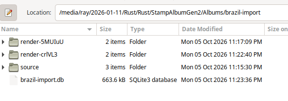
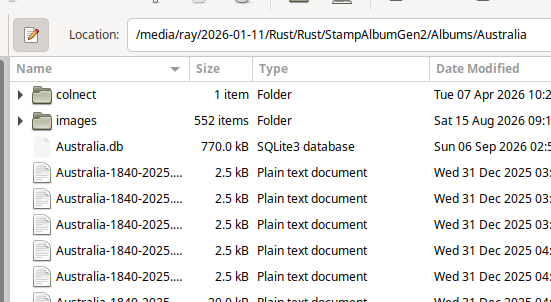

# Import and edit an external AlbumEasy album

The startup screen has a separate **Import & edit external AlbumEasy albums**
section. This converts an AlbumEasy document into a database-backed layout.
It is not a StampWorld scrape or a Colnect catalogue import.

A correct layout of the post-import album is shown below.

## Import wizard

1. Set **Albums Root** and configure the AlbumEasy executable using the existing
   setup controls. Do not put shell quotes around an executable path.
2. Click **Import AlbumEasy Album**. Select the original album folder, enter its
   entry text filename relative to that folder, and choose a new album name.
3. Inspect the source. Review the number of files/bytes to copy, pages,
   placements, image references, compatibility warnings, and blockers.
4. Confirm copying the entire folder. This includes unused images and supporting
   files. The original folder is never changed; existing albums are not merged.
5. Import and render. The app reconstructs commands from the database and renders
   both the original command document and the reconstruction in the copied album.
6. Open both fresh PDFs. Compare page count, headings, stamp positions, captions,
   borders and image spacing. Explicitly approve the reconstruction to enable
   editing. A successful render is not an automated visual-equivalence check.

A failed rendering remains a draft with its error visible. Correct the renderer
configuration or the copied draft's dependencies, then retry validation.
Do not treat an old PDF copied from the source as validation.

## Coverage and fidelity

Initial conversion coverage targets the commands in the Brazil example:
page size, margins (including even pages), borders, spacing, numbering, title,
box-size adjustment, legacy image settings, bottom row alignment, explicit pages,
centred text, fixed-spacing rows and image stamp boxes.

Unknown commands block conversion rather than being silently removed or replayed
as opaque source. Compatibility diagnostics retain source locations to inform
future command support. The obsolete `ALBUM_STAMP_IMG_SETTING` command retains
its original units; it must not be renamed to the newer command without a
reviewed conversion.

AlbumEasy box sizes are presentation dimensions, not necessarily physical stamp
dimensions. Image filenames are not inferred catalogue numbers. Repeated image
placements are retained.

Original snapshots are references. The database layout is authoritative for
regeneration. Existing automatically generated albums continue to use their
ordinary generation path.

## Editing

Open an imported album from the section's album list, then select a page.
The editor exposes commands in their original order and parameters in AlbumEasy
order. Text fields do not need surrounding quotes. Fonts and font sizes follow
AlbumEasy conventions; box dimensions and normal spacing are millimetres.

Edit existing parameters, remove elements, insert stamp placements/headings/row
settings, or move elements up/down. Upload local PNG/JPEG images (up to 5 MB);
paste the returned relative path into the placement image field. Uploading alone
does not create a placement.

**Save page & regenerate PDF** reflows the selected page only. Content that
cannot fit must be resolved rather than silently spilling onto another existing
page. Switching pages discards unsaved form edits. The editor uses revisions to
reject stale writes.

Successful edits keep an approved album ready; initial-import fidelity approval
is not requested again for intentional changes. Invalid edits are rejected.
If valid edits cannot render, the saved album becomes a retryable draft with
visible diagnostics, rather than claiming that its PDF is current.

Album-wide settings are separate and intentionally affect every page. Changing
them cannot be described as a page-local edit. The freshly rendered original PDF
remains an import reference and will not include subsequent database edits.

## Files, portability and restrictions

Images must be resolvable relative to the entry document. Folder capitalization
is preserved (`Images` and `images` are not interchangeable on Linux).
Unsafe paths, symlinks, case-colliding files and destination conflicts are
rejected. Select the album folder, not an unrelated large parent folder.
Aliases in the selected root's parent path are resolved; symlinks inside the
album and its dependencies are not followed.

The layout schema is additive. Imported albums use a dedicated editor rather
than the ordinary StampWorld/Colnect matching screen. Back up the entire album
directory, including its database and copied assets.

### Database migration notes

The importer adds `external_album`, `external_layout_commands`,
`external_layout_placements`, `external_layout_assets`,
`external_layout_sources`, and `external_layout_compatibility` tables alongside
the existing stamp schema. Each placement retains its own identity and linked
stamp record; duplicate image references are not discarded.

Layout metadata records lifecycle state and revision, structured command
arguments/order, asset checksums, source provenance and compatibility findings.
An ordinary database without import metadata continues to use ordinary album
generation. Imported databases are detected and dispatched to saved-layout
generation instead. The initial-development zero-based page metadata is
normalized/migrated to one-based pages without changing layout content;
the editor reserves selector zero for album-wide settings.

See the local [AlbumEasy companion](../AlbumEasy_4.2.1.pdf) for command semantics.
Real renderer behavior depends on the installed AlbumEasy version and fonts;
compare the reference and reconstruction on the same installation.
